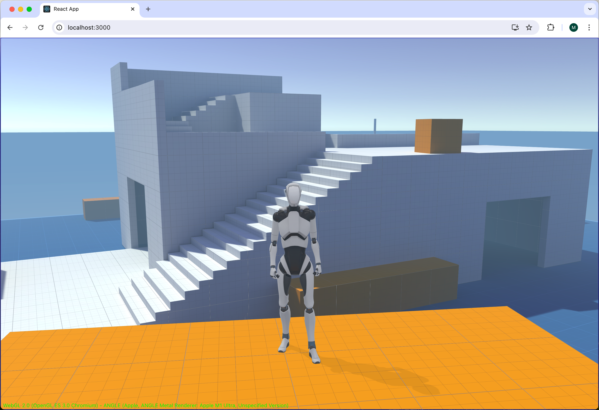

# Using Exported Unity Content




## Babylon Toolkit Extension

A universal runtime library for advanced BabylonJS game development.

https://github.com/BabylonJS/BabylonToolkit


## Awesome Design Documents

https://github.com/voltagent/awesome-design-md


## Unity Asset Store

The Starter Assets are free and light-weight first and third person character base controllers for the latest Unity 2023 LTS Or Greater

https://assetstore.unity.com/packages/essentials/starter-assets-character-controllers-urp-267961


* Default Installation (ES6)
```bash
npm install @babylonjs/core @babylonjs/gui @babylonjs/loaders @babylonjs/materials @babylonjs/inspector @babylonjs/serializers @babylonjs/havok @babylonjs/addons @babylonjs-toolkit/next
```

* Default Module Import Libraries
```javascript
import { Engine, Scene } from "@babylonjs/core";
import { HavokPlugin } from "@babylonjs/core/Physics/v2/Plugins/havokPlugin";
import HavokPhysics from "@babylonjs/havok";
import { SceneManager, ScriptComponent } from "@babylonjs-toolkit/next";
```

* Granular File Level Import Libraries
```javascript
import { Engine } from "@babylonjs/core/Engines/engine";
import { Scene } from "@babylonjs/core/scene";
import { HavokPlugin } from "@babylonjs/core/Physics/v2/Plugins/havokPlugin";
import HavokPhysics from "@babylonjs/havok";
import { SceneManager } from "@babylonjs-toolkit/next/scenemanager";
import { ScriptComponent } from "@babylonjs-toolkit/next/scenemanager";
import { LocalMessageBus } from "@babylonjs-toolkit/next/localmessagebus";
import { CharacterController } from "@babylonjs-toolkit/next/scenemanager";
```

* Legacy Global Namespace Import Libraries
```javascript
import * as BABYLON from "@babylonjs/core/Legacy/legacy";
import { HavokPlugin } from "@babylonjs/core/Physics/v2/Plugins/havokPlugin";
import HavokPhysics from "@babylonjs/havok";
import * as TOOLKIT from "@babylonjs-toolkit/next";
import * as PROJECT from "@babylonjs-toolkit/next/project";
```

### Vite Configuration (ES6)

The Vite bundle services behave differently in devmode than production. To preserve some required classes during devmode, these `exclude` and `include` settings are strongly recommended in your vite.config.js settings file.

* Important: The `dedupe` section of the `vite.config` is required for dual-instance hazard prevention. You must setup vite applications to `dedupe` ad Next.js to set `config simlink` to false.

```json
  optimizeDeps: {
    exclude: [
      "@babylonjs/core",
      "@babylonjs/loaders",
      "@babylonjs/gui",
      "@babylonjs/materials",
      "@babylonjs/serializers",
      "@babylonjs/addons",
      "@babylonjs/havok",
      "@babylonjs/inspector",
      "@babylonjs-toolkit/next",
      "@babylonjs-toolkit/next/project",
    ],
    include: mode === 'development' ? [
      "scheduler",
      "use-sync-external-store/shim"
    ] : [],
  },
```

* Starter Content Import Libraries
```javascript
import { DefaultCameraSystem, DebugInformation, StandardCarController } from "@babylonjs-toolkit/next/project";
```

### Content installer (game data download, offline play and fast loads)

The app can download its hosted game data to the player's device: the toolkit's `ContentInstaller` and its service
worker (`bt-content-worker.js`) store every file listed in the export's `content-manifest.json` in browser storage,
so later loads read it from the device (no network), the game runs offline, and an update downloads only the files
whose bytes changed. Downloading is optional and never a gate: without support, CORS or a manifest the game loads from
the network exactly as before.

* **The one switch.** Off by default. Add `VITE_CONTENT_INSTALLER=on` to `.env`. The content host is
  `VITE_SCENE_BASE_URL` (default `https://repo.babylontoolkit.com/playground/`); its `content-manifest.json` must be
  served next to the scenes (see the next section). The settings live in `src/config/contentInstaller.ts`.
* **What you get.** `ContentInstallerProvider` (in `src/app.tsx`) loads the installer once Home is idle — Home never
  loads Babylon code first. Home shows one **Download** button (it reads **Downloaded ✓** once every file of the game
  data is on the device). It opens the modal "Download Game Data" dialog (`ContentInstallPanel`; Escape closes it):
  *Not downloaded* — the game data size, what is already on this device and the free space, with Download and Cancel;
  *Downloading* — progress with percent, size and speed (no time-left estimate), with Pause (Resume while paused) and Close (the
  download keeps going in the background); *Downloaded* — "All game data is on this device", with Close and Remove (Remove deletes it and closes the dialog).
  No text the player sees says "install": adding the app to the desktop or home screen is the browser's own option.
  `ContentUpdateToast` announces new content ("New game content — 34 MB": Update, then Apply at the next scene load)
  and a new app version (Reload). An installed app (standalone launch) is offered the download once
  (`ContentInstallOffer`: "Download the game data to this device — 559 MB", Download / Maybe Later). Before every scene
  load `babylon.tsx` calls `prepareContentSceneLoad`; when the scene is on the device the splash reads
  "Loading from this device". The components are unstyled: skin their class hooks (`.content-install-panel__*`,
  `.content-toast*`, `.content-install-offer__*`) in your own CSS.
* **Local hosts.** On `localhost`, `127.0.0.1`, `*.local` and private network addresses the installer stays off (and
  removes its worker) unless `VITE_CONTENT_INSTALLER_LOCALHOST=on`, so a dev session behaves exactly as before.
* **The app shell.** `vite build` writes `bt-content-worker.js` and `bt-shell-manifest.json` (every built file with its
  SHA-256) into the build folder (`vite-content-installer.ts`), so an installed app also launches offline. A Vite dev
  session serves the worker but has no shell manifest.
* **Toolkit version.** The installer ships with the `@babylonjs-toolkit/next` release that adds
  `@babylonjs-toolkit/next/contentinstaller` and `workers/bt-content-worker.js`. With an older toolkit the Vite plugin
  warns once and serves no worker, and the layer stays unavailable.

### Hosting game content for the content installer

The asset host (S3, CloudFront, any CDN or web server) serves the exported `scenes/` folder with:

* **CORS** for `GET` and `HEAD` from the app's origin, exposing `Content-Length`, `ETag`, `Accept-Ranges` and
  `Content-Range`. Without CORS nothing is stored (one console warning) and the game still loads from the network.
* **`Content-Encoding: gzip`** on every `.gz.` file (`scene.gz.gltf`, `scene.gz.bin`) — the exporter's compressed
  scenes are stored pre-gzipped and the runtime never decompresses them itself.
* **`content-manifest.json` served `Cache-Control: no-cache`** (it changes with every content update), while the
  content files may be cached long (`max-age=31536000`): a changed file always changes its hash in the manifest.

S3 bucket CORS configuration:

```json
[
  {
    "AllowedOrigins": ["https://your-game.example.com"],
    "AllowedMethods": ["GET", "HEAD"],
    "AllowedHeaders": ["*"],
    "ExposeHeaders": ["Content-Length", "ETag", "Accept-Ranges", "Content-Range"],
    "MaxAgeSeconds": 600
  }
]
```

S3 object metadata: upload `.gz.` files with `Content-Encoding: gzip`, and `content-manifest.json` with
`Cache-Control: no-cache`.

CloudFront response headers policy (attach it to the content behaviour; forward the `Origin` header to the origin):

```json
{
  "ResponseHeadersPolicyConfig": {
    "Name": "game-content-cors",
    "CorsConfig": {
      "AccessControlAllowOrigins": { "Quantity": 1, "Items": ["https://your-game.example.com"] },
      "AccessControlAllowMethods": { "Quantity": 3, "Items": ["GET", "HEAD", "OPTIONS"] },
      "AccessControlAllowHeaders": { "Quantity": 1, "Items": ["*"] },
      "AccessControlExposeHeaders": { "Quantity": 4, "Items": ["Content-Length", "ETag", "Accept-Ranges", "Content-Range"] },
      "AccessControlAllowCredentials": false,
      "AccessControlMaxAgeSec": 600,
      "OriginOverride": true
    }
  }
}
```

Every successful export — a level, a container, a project build or a Build All — writes the `content-manifest.json`
of the scenes folder it wrote, with no setting to turn on. **Progressive Web App** in Canvas Tools only turns on
engine.html's downloader. To rebuild the manifest of any scenes folder, run
`unity command bt_build_content_manifest [--folder <scenes folder>]`; add `--check true` to compare it with the files
without writing anything (deploy scripts read `success` from `--format json`; `false` lists the differences).

**Deploy order:**

1. Run the check: `unity command bt_build_content_manifest --check true --folder <scenes folder> --format json`, and
   stop when `success` is `false`.
2. Upload the content files.
3. Upload `content-manifest.json` last.
4. Invalidate the manifest's path on the CDN (for example `/scenes/content-manifest.json` on CloudFront).

A manifest that arrives before its files, or a stale cached manifest, makes players fetch files that do not match it.

### Babylon Toolkit Starter Repositories (ES6)

* **Default Starter Project**: `https://github.com/babylontoolkit/StarterAssets.git`

* **Next.js Starter Project**: `https://github.com/babylontoolkit/VercelAssets.git`

---

Note: The **BABYLON** and **TOOLKIT** and **PROJECT*** namespaces are globally accessible for UMD style project script bundles.
